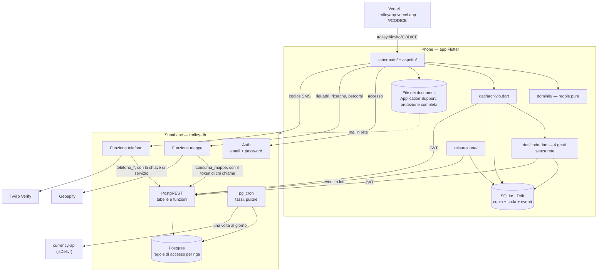

# Audit di Trolley — sicurezza e architettura

Data: 14 novembre 2026 · Stato del codice: `main` a `f3dd9a0` più il lavoro non committato (G.3) · Server: `trolley-db` (`nhdgxlynnudwkmxrrokp`)

Nessun file di codice è stato modificato. Il piano di intervento è in [PLAN.md](PLAN.md).

---

## 1. Executive summary

Il progetto è in salute, e sopra la media per un MVP: le regole di accesso per riga sono attive su ogni tabella e provate (22 file di prove SQL), nessun segreto è nel repository o nell'app, 885 prove passano e l'analisi statica è pulita. **Non ho trovato vulnerabilità critiche**: nessun modo per leggere o scrivere i dati di un viaggio a cui non si partecipa.

Quello che manca non è nel codice delle funzioni, ma intorno: è ciò che serve per passare da "lo provo io" a "lo provano altri". I cinque punti più urgenti:

1. **La beta non si può distribuire** (DIST-01): account Apple gratuito, profilo che scade ogni 7 giorni, niente TestFlight.
2. **Le pagine legali rispondono 404** (PRIV-01): l'app le apre dalla schermata di accesso, ma informativa, misurazione e condizioni non sono pubblicate.
3. **Un solo ambiente, senza copie di sicurezza** (ARCH-01, REL-01): sviluppo, prove e dati veri stanno nello stesso database, sul piano gratuito.
4. **Chi dimentica la password resta fuori** (SEC-02), e la configurazione dell'accesso è quella predefinita (SEC-03).
5. **Uscire dall'account non svuota il telefono** (SEC-01): copia, coda ed eventi restano per chi entra dopo. E in beta **non sapresti dei crash** (OBS-01): non c'è nessuna raccolta degli errori.

---

## 2. Com'è fatto oggi

### Struttura

| Parte | Dove | Cosa contiene |
|---|---|---|
| App | `app/lib/` (144 file, ~58.000 righe scritte a mano) | `dominio/` 31 file di regole pure · `dati/` 25 file: copia locale (Drift), coda, server, fornitori · `aspetto/` 20 file · `schermate/` 68 file · `misurazione/` · `invito/` |
| Prove dell'app | `app/test/` (90 file, 885 prove) | Dominio, dati, schermate, aspetto |
| Server | `supabase/migrations/` (28 file, ~5.800 righe) | Schema, regole di accesso, ~60 funzioni, 5 lavori pianificati |
| Funzioni | `supabase/functions/` | `mappe` (Geoapify), `telefono` (Twilio Verify) |
| Prove del server | `supabase/tests/` (22 file, ~4.600 righe) | Regole di accesso e funzioni, in transazioni che si annullano |
| Sito | `sito/` su Vercel | Pagina d'invito, tre pagine legali (non pubblicate) |

**Punto d'ingresso**: [app/lib/main.dart](app/lib/main.dart) costruisce i servizi e li passa all'albero con un `InheritedWidget` ([servizi.dart](app/lib/servizi.dart)). [app.dart](app/lib/app.dart) decide la fase (avvio, accesso, profilo, pronto, errore) ascoltando lo stato dell'accesso. La navigazione è imperativa (`Navigator`), con una pila per sezione ([sezioni.dart](app/lib/schermate/sezioni.dart), ADR-013). Non c'è una libreria di gestione dello stato: le schermate leggono la copia locale con `StreamBuilder` (93 usi) e tengono lo stato proprio con `setState` (296 usi).

**Strati**: schermate → `Archivio` / servizi in `dati/` → copia locale e server. Nessuna schermata chiama il server direttamente (verificato). Le regole stanno in `dominio/`, senza dipendenze da Flutter o dalla rete.

### Diagramma

### Flussi principali

- **Accesso**: email e password con Supabase Auth ([accesso.dart](app/lib/schermate/accesso.dart)). La conferma dell'email torna con `trolley://accesso`. Uscita da Impostazioni. **Non esistono** recupero né cambio della password.
- **Autorizzazione**: tutta nel database. Ogni tabella di un viaggio ha regole che passano da `privato.e_partecipante(viaggio_id)`; la partecipazione si cambia solo con funzioni dedicate; i permessi sono dati per colonna dove conta (`utente`, `viaggio`, `voce_lista`, `nota`, `invito`, `evento`).
- **Lettura**: `Archivio.aggiornaCopia` riscarica i viaggi e il contenuto di quelli non finiti, e li mette nella copia; le schermate leggono solo la copia.
- **Scrittura**: con la rete, chiamate dirette con la `versione` (blocco ottimistico, `TR409`). Senza rete, quattro gesti in coda, idempotenti, applicati subito alla copia.
- **Documenti**: mai in rete. File in Application Support con `FileProtectionType.complete`, indice in SQLite, visibili solo a chi li ha aggiunti.
- **Pagamenti, webhook, caricamento di file sul server**: non esistono. Il server non ha object storage.

### Configurazione

- **Ambiente**: indirizzo e chiave pubblicabile di Supabase sono valori predefiniti in [configurazione.dart](app/lib/configurazione.dart), sostituibili con `--dart-define`. Esiste **un solo progetto** Supabase.
- **Segreti**: `GEOAPIFY_CHIAVE`, `TWILIO_*`, `TELEFONO_PROVA` sono segreti delle funzioni. Nel repository non ce ne sono (verificato: `.gitignore`, storia di git, `sito/.env.local` ignorato).
- **Migrazioni**: 28 file, tutte registrate sul server (verificato con l'elenco delle versioni). Le applica a mano il proprietario dall'editor SQL.
- **CI/CD**: assente. Nessuna cartella `.github`. Build e installazione a mano da Xcode.
- **Dipendenze**: 24 dirette, tutte recenti e mantenute. 59 aggiornabili entro i vincoli (fra cui `supabase_flutter` 2.18.0 → 2.18.3 e `sqlite3` 3.5.2 → 3.9.1). Nel file di blocco compaiono `sqlite3_flutter_libs 0.6.0+eol` e `sqlcipher_flutter_libs 0.7.0+eol`, versioni segnate a fine vita dai loro autori.

---

## 3. Problemi

Gravità per la sicurezza: impatto × probabilità, valutati per una beta chiusa fra amici e parenti con la parte pubblica ancora spenta. Effort: S meno di un'ora, M 1–4 ore, L 1–2 giorni, XL più di 2 giorni.

### Sicurezza

#### SEC-01 — Uscire dall'account non svuota il telefono
- **Gravità**: Media (impatto medio × probabilità media: capita a chi prova con due account, o presta il telefono)
- **Dove**: [impostazioni.dart:142](app/lib/schermate/impostazioni.dart#L142), [nuovo_profilo.dart:222](app/lib/schermate/nuovo_profilo.dart#L222) chiamano solo `auth.signOut()`. `svuotaLaCopia` ([archivio.dart:235](app/lib/dati/archivio.dart#L235)) è usata solo dalla chiusura dell'account ([account.dart:57](app/lib/dati/account.dart#L57)).
- **Descrizione**: dopo "Esci" restano nel database locale la copia dei viaggi, la coda dei gesti e gli eventi non ancora inviati. Nessuna di queste tabelle sa di chi è.
- **Scenario**: Anna esce, Bruno entra sullo stesso telefono. (1) Finché la copia non si riaggiorna — sempre, se manca la rete — Bruno vede viaggi, spese e nomi dei compagni di Anna. (2) Gli eventi in attesa di Anna partono con l'accesso di Bruno e gli vengono attribuiti ([misurazione.dart:188](app/lib/misurazione/misurazione.dart#L188)): una misurazione falsata e un dato personale sulla persona sbagliata. (3) I gesti in coda di Anna partono con l'accesso di Bruno: il server li rifiuta o non trova la riga, e vanno persi.
- **Raccomandazione**: un solo gesto di uscita che prima prova a mandare coda ed eventi, avvisa se qualcosa non è partito, svuota la copia e poi esce. In più, all'ingresso, un controllo: se l'ultima persona entrata su questo telefono è un'altra, la copia si svuota.
- **Effort**: M

#### SEC-02 — Non c'è modo di recuperare o cambiare la password
- **Gravità**: Alta (impatto alto: perdita dell'account e dei viaggi; probabilità alta su qualche decina di persone in pochi mesi)
- **Dove**: [accesso.dart](app/lib/schermate/accesso.dart) ha solo `signUp` e `signInWithPassword`; in tutta l'app non compaiono `resetPasswordForEmail` né `updateUser`.
- **Descrizione**: chi dimentica la password non rientra più. L'unico rimedio è un intervento a mano sul pannello di Supabase. Non si può nemmeno cambiare una password che si teme compromessa.
- **Raccomandazione**: "Password dimenticata?" con il link via email e la schermata della nuova password; "Cambia password" in Impostazioni. La schermata va prima disegnata sulla tela.
- **Effort**: L

#### SEC-03 — Configurazione dell'accesso lasciata ai valori predefiniti
- **Gravità**: Media
- **Dove**: pannello di Supabase (Authentication). Nel repository non c'è un `supabase/config.toml` che la descriva.
- **Accertato**: la protezione dalle password compromesse è spenta (lo segnala il controllo di sicurezza di Supabase; è già in `docs/punti-aperti.md`). Il messaggio dell'app parla di 6 caratteri minimi ([errori.dart:123](app/lib/dati/errori.dart#L123)).
- **Ipotesi, da verificare a mano**: 2 dei 3 utenti di `auth.users` non hanno l'email confermata eppure hanno un profilo: o la conferma dell'email è spenta, o sono persone di prova create da SQL. L'invio delle email usa con ogni probabilità il servizio predefinito di Supabase, che ne manda pochissime all'ora: con dieci iscrizioni la stessa sera, le conferme non arrivano.
- **Scenario**: senza conferma dell'email, chiunque crea un account con l'indirizzo di un altro; con password di 6 caratteri e senza controllo sulle password note, un attacco a dizionario sull'accesso ha buone probabilità su qualche account.
- **Raccomandazione**: lunghezza minima 10, protezione dalle password compromesse, conferma dell'email accesa, un servizio SMTP proprio, limiti di frequenza rivisti, e gli indirizzi di ritorno ridotti a `trolley://accesso`. Vedi "Da verificare a mano".
- **Effort**: M (più la scelta di un fornitore di posta)

#### SEC-04 — La sessione è salvata fuori dal Portachiavi
- **Gravità**: Media (impatto alto × probabilità bassa)
- **Dove**: [main.dart:29-33](app/lib/main.dart#L29-L33): `Supabase.initialize` senza `authOptions`, quindi con il deposito predefinito di `supabase_flutter`, che è `shared_preferences` (su iOS: le preferenze dell'app, in chiaro).
- **Scenario**: il token di rinnovo finisce nei backup non cifrati del telefono e in qualunque copia del contenitore dell'app. Chi lo legge prende l'account, finché la persona non esce.
- **Raccomandazione**: deposito nel Portachiavi (`flutter_secure_storage`), con la migrazione della sessione esistente.
- **Effort**: M

#### SEC-05 — Il tetto delle mappe si aggira creando viaggi, e non ha un limite complessivo
- **Gravità**: Media (impatto medio: mappa spenta per tutti; probabilità bassa in beta, ma basta un account)
- **Dove**: [tetto_mappe.sql:47-94](supabase/migrations/20261008090000_tetto_mappe.sql#L47-L94): il conteggio è per (persona, viaggio, giorno).
- **Scenario**: chiunque può registrarsi con la chiave pubblicabile, che è nell'app per definizione. Un account crea cento viaggi con `crea_viaggio` e per ciascuno consuma 2.000 riquadri: la quota giornaliera di Geoapify finisce e la mappa smette di funzionare per tutti. La verifica del telefono ha già un tetto complessivo (`invii_giorno`); le mappe no.
- **Raccomandazione**: il tetto per persona conta tutti i suoi viaggi; in più un tetto complessivo al giorno, sotto la quota del fornitore.
- **Effort**: M

#### SEC-06 — Il server non limita lunghezza e volume di quasi nessun testo
- **Gravità**: Media (impatto medio × probabilità bassa)
- **Dove**: [schema_iniziale.sql](supabase/migrations/20260930184147_schema_iniziale.sql): `utente.nome` (riga 40), `viaggio.destinazione_citta` e `periodo_approssimativo` (84-86), `tappa.titolo` e `luogo_nome` (176-177), `spesa.descrizione` (244), `evento.nome` e `evento.proprieta` (303-304). Hanno un limite solo `voce_lista.testo`, `nota.testo`, i messaggi e le segnalazioni.
- **Scenario**: un account scrive megabyte in una tappa o in un evento, ripetutamente: il database gratuito (500 MB) si riempie e passa in sola lettura per tutti. Oppure un partecipante gonfia un viaggio condiviso e la copia degli altri non si scarica più entro il timeout. Un nome lunghissimo rompe le schermate dei compagni.
- **Raccomandazione**: vincoli di lunghezza allineati a quelli dei campi dell'app; nome dell'evento in forma `[a-z_]`, proprietà entro pochi kilobyte.
- **Effort**: M

#### SEC-07 — Chiunque può registrarsi durante la beta chiusa
- **Gravità**: Bassa
- **Dove**: Supabase Auth, iscrizione aperta; [configurazione.dart:16-19](app/lib/configurazione.dart#L16-L19).
- **Descrizione**: la chiave pubblicabile nell'app è corretta, e i dati li proteggono le regole di accesso. Ma con l'iscrizione aperta chi estrae indirizzo e chiave dal pacchetto può creare account a volontà, e da lì partono SEC-05 e SEC-06.
- **Raccomandazione**: per la beta, protezione dai bot (CAPTCHA di Supabase) e limiti di frequenza sull'iscrizione. Una lista di email ammesse è possibile ma costa manutenzione.
- **Effort**: S–M

#### SEC-08 — I codici d'invito non scadono, e i tentativi non sono contati
- **Gravità**: Bassa (impatto alto: chi entra legge tutto il viaggio; probabilità molto bassa)
- **Dove**: [schema_iniziale.sql:202-229](supabase/migrations/20260930184147_schema_iniziale.sql#L202-L229) (8 caratteri su 31, circa 8,5 × 10¹¹ combinazioni); [partecipanti.sql:139-194](supabase/migrations/20261004093000_partecipanti.sql#L139-L194).
- **Scenario**: (1) un link inoltrato in una chat resta valido per sempre, finché qualcuno non viene tolto dal viaggio: chi lo trova mesi dopo entra. (2) Con un account si provano codici a caso con `accetta_invito`: indovinarne uno è improbabile con pochi inviti attivi, ma niente lo frena.
- **Raccomandazione**: scadenza (per esempio 30 giorni, o la fine del viaggio) e un tetto giornaliero ai codici sbagliati per persona.
- **Effort**: M

#### SEC-09 — I numeri di prova della verifica del telefono
- **Gravità**: Bassa oggi (parte pubblica chiusa), Alta se resta quando apre
- **Dove**: [telefono/index.ts:33-39, 136, 173](supabase/functions/telefono/index.ts#L33-L39); segreto `TELEFONO_PROVA`.
- **Descrizione**: chi conosce un numero di prova e il suo codice si verifica senza un telefono. Già in `docs/punti-aperti.md`. Lo riporto perché deve diventare un passo esplicito prima di aprire la parte pubblica.
- **Effort**: S

#### SEC-10 — Una sospensione si aggira chiudendo l'account
- **Gravità**: Bassa oggi, Media con la parte pubblica aperta
- **Dove**: [sicurezza.sql:895-911](supabase/migrations/20261009090000_sicurezza.sql#L895-L911): `chiudi_account` cancella il numero verificato e azzera la sospensione.
- **Scenario**: una persona sospesa chiude l'account, ne crea uno nuovo e verifica lo stesso numero.
- **Raccomandazione**: alla chiusura di un account sospeso conservare un'impronta del numero (non il numero) per un periodo dichiarato nell'informativa.
- **Effort**: M

#### SEC-11 — Verifica e traguardi li dichiara l'app
- **Gravità**: Bassa
- **Dove**: [sul_posto.sql:22-57](supabase/migrations/20261006090000_sul_posto.sql#L22-L57); [chiusura.sql:175-200](supabase/migrations/20261006120000_chiusura.sql#L175-L200): `prendi_traguardi` accetta qualunque testo fino a 40 caratteri come tipo.
- **Descrizione**: chi chiama il server senza l'app si dichiara sul posto e si assegna qualunque traguardo, anche inesistente. È una scelta documentata ("una barriera, non una prova"). Il conteggio dei traguardi però compare sul profilo pubblico.
- **Raccomandazione**: almeno l'elenco dei tipi ammessi sul server. App Attest resta per dopo.
- **Effort**: S

#### SEC-12 — Il sito non ha le intestazioni di sicurezza
- **Gravità**: Bassa
- **Dove**: [sito/vercel.json](sito/vercel.json). Verificato in produzione: ci sono HSTS, `Referrer-Policy` e `X-Robots-Tag`; mancano `Content-Security-Policy`, `X-Frame-Options`, `X-Content-Type-Options`.
- **Descrizione**: la pagina d'invito non tratta dati e scrive il codice con `textContent`, quindi il rischio concreto è minimo (una pagina incorniciata da un altro sito).
- **Effort**: S

#### SEC-13 — Cinque funzioni interne restano eseguibili da chi non ha un accesso
- **Gravità**: Bassa (igiene)
- **Dove**: [sicurezza.sql:59-101, 135-146, 379-390](supabase/migrations/20261009090000_sicurezza.sql#L59-L101): `privato.parte_pubblica`, `parte_pubblica_visibile`, `accoglie`, `tetto_telefono`, `si_bloccano` non hanno la revoca. Verificato sul server.
- **Descrizione**: non sono raggiungibili, perché lo schema `privato` non è esposto e il ruolo anonimo non può usarlo. Ma la difesa è una sola: se un giorno lo schema venisse esposto, si aprirebbero.
- **Raccomandazione**: revoca esplicita, e privilegi predefiniti che tolgano l'esecuzione a `public` per le funzioni future.
- **Effort**: S

#### SEC-14 — Permessi di scrittura larghi su giorni, tappe, spese e quote
- **Gravità**: Bassa
- **Dove**: [regole_di_accesso.sql:137-161](supabase/migrations/20260930184217_regole_di_accesso.sql#L137-L161): `grant select, insert, update` sull'intera tabella, mentre `viaggio`, `voce_lista`, `nota` hanno permessi per colonna.
- **Scenario**: chi partecipa a due viaggi può spostare una spesa dall'uno all'altro cambiando `viaggio_id`, o toccare colonne che l'app non scrive mai (`eccedente`, `marcata_durante_il_viaggio` su righe altrui). Non esce dai viaggi a cui partecipa.
- **Raccomandazione**: permessi per colonna, come sulle altre tabelle.
- **Effort**: M

#### SEC-15 — La copia locale non è cifrata
- **Gravità**: Bassa
- **Dove**: [database.dart:416](app/lib/dati/database.dart#L416). I documenti hanno la protezione completa; il database e i riquadri di mappa hanno quella predefinita di iOS (leggibili dopo il primo sblocco).
- **Raccomandazione**: protezione dei file più stretta sul database; la cifratura con SQLCipher non serve a questo stadio.
- **Effort**: S–M

#### SEC-16 — I tassi di cambio arrivano da una fonte non verificata
- **Gravità**: Bassa
- **Dove**: [spese_e_tassi.sql:67-98](supabase/migrations/20261003090000_spese_e_tassi.sql#L67-L98): pacchetto `@latest` da jsDelivr.
- **Scenario**: un pacchetto manomesso pubblica un tasso sbagliato; il server lo accetta se è un numero positivo, e le conversioni delle spese ne escono falsate.
- **Raccomandazione**: scartare i tassi che si muovono oltre una soglia rispetto al giorno prima.
- **Effort**: S

#### SEC-17 — Nessuna traccia di chi modera
- **Gravità**: Bassa
- **Dove**: schema `moderazione` in [sicurezza.sql:609-753](supabase/migrations/20261009090000_sicurezza.sql#L609-L753).
- **Descrizione**: una sospensione lascia l'esito e la nota sulla segnalazione, non chi l'ha decisa. Con un solo moderatore non serve; con due sì.
- **Effort**: S

### Privacy e conformità

#### PRIV-01 — Le pagine legali non sono pubblicate
- **Gravità**: Alta (bloccante prima di dare l'app a chiunque)
- **Dove**: verificato il 14 novembre: `/privacy`, `/misurazione`, `/condizioni` su `trolleyapp.vercel.app` rispondono 404. L'app le apre da [accesso.dart:148-153](app/lib/schermate/accesso.dart#L148-L153). Nell'informativa mancano ancora titolare e contatto (già in `docs/punti-aperti.md`).
- **Descrizione**: si raccolgono email, data di nascita e dati dei viaggi senza che l'informativa sia leggibile.
- **Effort**: S per pubblicare; la decisione su titolare e contatto è fuori dal codice.

#### PRIV-02 — La misurazione parte accesa
- **Gravità**: Media — **da verificare con chi rivede la parte legale**
- **Dove**: [misurazione.dart:122-127](app/lib/misurazione/misurazione.dart#L122-L127): attiva finché la persona non la spegne; gli eventi portano l'identificativo dell'utente.
- **Descrizione**: gli eventi sono minimi e senza contenuti, e si spengono dalle Impostazioni. Resta da confermare la base giuridica di una misurazione legata alla persona senza consenso esplicito. Non è definita una durata di conservazione degli eventi.
- **Effort**: dipende dalla risposta

#### PRIV-03 — Manca il manifesto della privacy di iOS
- **Gravità**: Media (serve per TestFlight esterno e App Store)
- **Dove**: non esiste `app/ios/Runner/PrivacyInfo.xcprivacy`.
- **Effort**: M, insieme alle dichiarazioni di privacy dello store

### Distribuzione

#### DIST-01 — La beta non si può distribuire
- **Gravità**: Alta (è l'obiettivo dichiarato)
- **Dove**: firma con il team personale gratuito; profilo che scade ogni 7 giorni; nessun link universale (la pagina d'invito apre `trolley://`).
- **Descrizione**: senza l'Apple Developer Program non c'è TestFlight, e ogni tester andrebbe installato a mano dal Mac ogni settimana. Già in `docs/punti-aperti.md`: lo riporto perché tutto il piano ne dipende.
- **Effort**: S per l'iscrizione, L per TestFlight, link universali e dominio

#### DIST-02 — Il numero di versione è scritto in due posti
- **Gravità**: Bassa
- **Dove**: [configurazione.dart:33](app/lib/configurazione.dart#L33) (`versioneApp = '0.1.0'`) e [pubspec.yaml:4](app/pubspec.yaml#L4).
- **Descrizione**: gli eventi portano la versione scritta a mano: con più build in giro, basta dimenticarsi una volta e le misure di due versioni si confondono.
- **Effort**: S

### Architettura e affidabilità

#### ARCH-01 — Un solo ambiente: sviluppo e dati veri insieme
- **Gravità**: Alta
- **Dove**: [configurazione.dart:11-19](app/lib/configurazione.dart#L11-L19); migrazioni e prove lanciate su `trolley-db`, dove ci sono anche persone di prova.
- **Descrizione**: dal primo tester in poi, ogni migrazione provata e ogni prova SQL girano accanto ai dati di persone vere. Le prove si annullano da sole, ma una migrazione sbagliata no.
- **Raccomandazione**: un progetto di produzione separato; quello attuale resta di sviluppo.
- **Effort**: L

#### REL-01 — Nessuna copia di sicurezza, e il progetto gratuito si ferma
- **Gravità**: Alta
- **Dove**: piano gratuito di Supabase (già in `docs/punti-aperti.md`).
- **Descrizione**: un errore non si recupera. In più i progetti gratuiti vengono messi in pausa dopo un periodo senza attività (da verificare sul piano attuale): in una beta piccola può succedere, e l'app smetterebbe di funzionare per tutti.
- **Raccomandazione**: piano a pagamento all'apertura della beta, oppure un `pg_dump` cifrato e pianificato.
- **Effort**: S (piano) o M (dump)

#### OBS-01 — In beta non sapresti dei crash
- **Gravità**: Alta
- **Dove**: nessun gestore globale degli errori (`FlutterError.onError`, `PlatformDispatcher.onError`) in [main.dart](app/lib/main.dart); 37 punti dell'app ingoiano gli errori in silenzio.
- **Descrizione**: un crash o un errore ricorrente sul telefono di un tester non lascia traccia da nessuna parte. Le funzioni del server non scrivono registri propri.
- **Raccomandazione**: raccogliere tipo dell'errore, traccia e versione, senza contenuti. Due strade: un servizio esterno (un fornitore in più da dichiarare) o una tabella propria sullo stesso server.
- **Effort**: M–L

#### ARCH-02 — Manca una versione minima dell'app
- **Gravità**: Media
- **Dove**: nessun controllo all'avvio; la tabella `configurazione` esiste già e si legge dall'app.
- **Descrizione**: con più build in mano ai tester, una migrazione che cambia una funzione rompe in silenzio le versioni vecchie. Non c'è modo di dire "aggiorna".
- **Effort**: M

#### REL-02 — Un guasto momentaneo del server mette da parte i gesti in coda
- **Gravità**: Media
- **Dove**: [errori.dart:72-77](app/lib/dati/errori.dart#L72-L77) tratta ogni risposta del server come un rifiuto; [coda.dart](app/lib/dati/coda.dart) (`_svuota`, `_rifiutata`) dopo 3 rifiuti mette il gesto da parte.
- **Descrizione**: un errore 5xx, un timeout dell'istruzione (8 secondi sul server) o un 429 non sono un "no" definitivo, ma contano come tale. I tre tentativi si consumano in pochi secondi, perché la coda riparte a ogni gesto. Niente va perso — la persona può riprovare dalla schermata dei problemi — ma vede un errore che non la riguarda.
- **Raccomandazione**: distinguere gli errori momentanei e trattarli come assenza di rete.
- **Effort**: M

#### REL-03 — La copia si scarica intera e senza pagine
- **Gravità**: Media
- **Dove**: [archivio.dart:256-345](app/lib/dati/archivio.dart#L256-L345): una `select` per tabella su tutti i viaggi non finiti, senza `range`.
- **Descrizione**: PostgREST taglia le risposte al numero massimo di righe (1.000 predefinito su Supabase, da verificare in Settings → API). Le righe tagliate vengono poi **cancellate dalla copia**, perché la copia si rifà con quello che è arrivato: tappe o spese sparirebbero dal telefono senza un errore. Dieci viaggi di dieci giorni con otto tappe sono già 800 righe.
- **Raccomandazione**: scaricare a pagine, o un viaggio per volta.
- **Effort**: M–L

#### ARCH-03 — `Archivio` fa tutto
- **Gravità**: Media
- **Dove**: [archivio.dart](app/lib/dati/archivio.dart): 2.758 righe, 113 metodi pubblici. Anche [mappa.dart](app/lib/schermate/mappa.dart) (2.021), [adesso.dart](app/lib/schermate/adesso.dart) (1.467), [itinerario.dart](app/lib/schermate/itinerario.dart) (1.432).
- **Descrizione**: ogni funzione nuova tocca lo stesso file; le prove devono costruirlo tutto. Non è un difetto oggi, è il punto dove il costo di ogni modifica crescerà.
- **Raccomandazione**: dividerlo per area (viaggi, spese, liste, partecipanti, account), una alla volta, senza cambiare le schermate.
- **Effort**: XL, a pezzi

#### ARCH-04 — Un evento rifiutato blocca tutti gli altri
- **Gravità**: Bassa
- **Dove**: [misurazione.dart:188-222](app/lib/misurazione/misurazione.dart#L188-L222).
- **Descrizione**: se il server rifiuta un lotto, l'invio si ferma e riprova lo stesso lotto per sempre. Poiché la misurazione è "l'unico strumento di verifica rimasto", un solo evento malformato la spegnerebbe senza che nessuno se ne accorga. Diventa più probabile con i vincoli di SEC-06.
- **Effort**: M

#### ARCH-05 — `i_miei_dati` e `chiudi_account` si riscrivono a ogni tabella nuova
- **Gravità**: Bassa
- **Dove**: le due funzioni sono ricopiate per intero in quattro migrazioni.
- **Descrizione**: una tabella nuova con dati personali deve ricordarsi di entrare in tutte e due. Oggi lo garantisce solo l'attenzione.
- **Raccomandazione**: una prova che fallisce se una tabella con una colonna verso `utente` non compare nelle due funzioni.
- **Effort**: M

### Prestazioni e scala

#### PERF-01 — Ogni riquadro di mappa costa una funzione e due scritture
- **Gravità**: Media a 100×, trascurabile oggi
- **Dove**: [mappe/index.ts:114-146](supabase/functions/mappe/index.ts#L114-L146); [tetto_mappe.sql:74-90](supabase/migrations/20261008090000_tetto_mappe.sql#L74-L90).
- **Descrizione**: una schermata di mappa chiede 20–40 riquadri; ciascuno è un'invocazione della funzione, una chiamata al database con inserimento e aggiornamento, e una chiamata a Geoapify. Con 10× utenti regge; con 100× si toccano i limiti di invocazioni e di connessioni prima di quelli di Geoapify.
- **Raccomandazione**: contare a blocchi, o un permesso firmato di breve durata che la funzione verifica senza database.
- **Effort**: L

#### PERF-02 — La sincronizzazione è sempre totale
- **Gravità**: Bassa oggi, Media a 100×
- **Dove**: [archivio.dart:256](app/lib/dati/archivio.dart#L256).
- **Descrizione**: a ogni apertura si riscarica tutto, anche se non è cambiato niente. Non esistono indici su `modificato_il`.
- **Raccomandazione**: aspettare i numeri della beta; poi scaricare solo ciò che è cambiato.
- **Effort**: XL

#### PERF-03 — La ricerca dei viaggiatori scorre tutti gli utenti
- **Gravità**: Bassa finché la parte pubblica è chiusa
- **Dove**: [profilo_pubblico.sql:343-362](supabase/migrations/20261010090000_profilo_pubblico.sql#L343-L362).
- **Descrizione**: per ogni utente si chiamano più funzioni, e `viaggi_del_profilo` fino a tre volte. Il tetto di 60 ricerche al giorno limita il danno.
- **Effort**: L, quando servirà

### Qualità e lavoro quotidiano

#### QUAL-01 — Il lavoro di sei giorni non è committato
- **Gravità**: Media
- **Dove**: 46 file modificati e 8 nuovi; `origin/main` è fermo al 27 ottobre.
- **Descrizione**: esiste solo su questo Mac.
- **Effort**: S

#### QUAL-02 — Nessuna integrazione continua
- **Gravità**: Media
- **Dove**: nessuna cartella `.github`.
- **Descrizione**: 885 prove dell'app e 22 file di prove SQL girano solo quando qualcuno se ne ricorda. Le prove delle regole di accesso sono la vera rete di sicurezza e non girano in automatico.
- **Effort**: M–L

#### QUAL-03 — Dipendenze da aggiornare, vulnerabilità non controllate
- **Gravità**: Bassa
- **Dove**: [pubspec.lock](app/pubspec.lock).
- **Descrizione**: 59 aggiornamenti disponibili entro i vincoli. Non ho potuto confrontare le versioni con un archivio di vulnerabilità: è un controllo da aggiungere (vedi "Da verificare a mano"). Vanno capiti i due pacchetti `+eol`.
- **Effort**: M

#### QUAL-04 — Nessuna prova dei flussi interi
- **Gravità**: Bassa
- **Dove**: non esiste `app/integration_test/`.
- **Descrizione**: le prove coprono bene dominio e dati con server finti. Nessuna prova percorre un flusso vero contro un server vero: iscrizione, invito accettato, spesa senza rete e ritorno.
- **Effort**: L

#### DX-01 — La configurazione del server non è nel repository
- **Gravità**: Bassa
- **Dove**: manca `supabase/config.toml`; manca un README alla radice. È tracciato per errore `supabase/.temp/cli-latest`.
- **Descrizione**: `verify_jwt` spento sulle due funzioni dipende da un'opzione ricordata a mano al momento della pubblicazione. Le impostazioni dell'accesso vivono solo nel pannello. Rifare il progetto da zero — serve per ARCH-01 — richiede passi non scritti.
- **Effort**: M

---

## 4. Da verificare a mano

Cose che il codice non può dire.

| Cosa | Dove guardare | Cosa aspettarsi |
|---|---|---|
| Conferma dell'email | Supabase → Authentication → Sign In / Providers → Email | "Confirm email" acceso |
| Lunghezza minima e password compromesse | Authentication → Policies (o Password security) | Almeno 10 caratteri; protezione accesa |
| Indirizzi di ritorno | Authentication → URL Configuration | Solo `trolley://accesso`; nessun carattere jolly |
| Servizio di posta | Authentication → Emails → SMTP | Un SMTP proprio, non quello predefinito |
| Limiti di frequenza | Authentication → Rate Limits | Iscrizioni e accessi limitati per indirizzo IP |
| Durata della sessione | Authentication → Sessions | Rotazione dei token di rinnovo accesa |
| Righe massime per risposta | Settings → API → Max rows | Il valore che governa REL-03 |
| Schemi esposti | Settings → API → Exposed schemas | Solo `public` (mai `privato`, mai `moderazione`) |
| Pausa del progetto | Piano e stato del progetto | Se il piano attuale mette in pausa per inattività |
| Segreti delle funzioni | Edge Functions → Secrets | `TELEFONO_PROVA` presente o no; nessun segreto in più |
| Quota e limiti di Geoapify | Pannello di Geoapify | Quota giornaliera, per scegliere il tetto complessivo |
| Limite di spesa di Twilio | Pannello di Twilio | Un tetto di spesa e i paesi ammessi per gli SMS |
| Repository privato | GitHub → Settings | Privato; scansione dei segreti accesa |
| Vulnerabilità note | `osv-scanner --lockfile app/pubspec.lock` | Nessuna, o un elenco da valutare |
| Protezione dei rami | GitHub → Branches | Quando ci sarà la CI |

---

## 5. Migliorie possibili

Non sono problemi.

- **Accesso con Apple e con Google**: riduce le password da gestire, ed è previsto dal capitolo 01. Con Apple va aggiunta la revoca del token alla chiusura dell'account.
- **Notifiche dal server**: oggi i promemoria sono solo locali; i compagni non sanno di una modifica finché non aprono l'app.
- **Aggiornamenti in tempo reale** dentro un viaggio aperto: ridurrebbe i conflitti invece di mostrarli dopo.
- **Tema scuro**: l'app è forzata al chiaro ([Info.plist](app/ios/Runner/Info.plist), [app.dart:221](app/lib/app.dart#L221)) pur avendo i temi scuri definiti.
- **Orientamento**: l'orizzontale è abilitato in `Info.plist`; se le schermate non sono pensate per quello, conviene toglierlo.
- **Accessibilità**: un passaggio con VoiceOver e con i caratteri ingranditi, insieme alla revisione grafica che hai già in programma.
- **Cambiare nome dall'app**: oggi si può solo scrivendo al supporto.
- **App Attest**: per rendere "sul posto" una prova e non una barriera, quando la parte pubblica aprirà.
- **Un cruscotto delle misure**: gli eventi ci sono; mancano le interrogazioni salvate che rispondono alle ipotesi di `docs/discovery/03`.

---

## 6. Cose fatte bene, da preservare

- **Le regole di accesso sono la sicurezza, e sono provate.** Tutte le tabelle le hanno attive (verificato sul server), il ruolo anonimo non ha alcun permesso, e ogni migrazione ha il suo file di prove. È la cosa più importante del progetto.
- **Permessi per colonna.** Data di nascita, account interno, telefono verificato, deroga e stato pubblico non si possono scrivere dall'app. Dei compagni si legge solo il nome.
- **Funzioni con privilegi scritte con cura.** Tutte fissano `search_path` (verificato: nessuna eccezione), controllano chi chiama, e quelle interne stanno in uno schema non esposto.
- **Nessun segreto nell'app.** Le chiavi di Geoapify e di Twilio stanno solo sul server; la chiave di servizio è usata solo dalla funzione `telefono`, per tre funzioni che nessun altro può chiamare.
- **I documenti non lasciano il telefono**, hanno la protezione completa dei file e c'è una prova dedicata (`documenti_restano_qui_test.dart`).
- **La coda senza rete.** Gesti idempotenti, ordine conservato per viaggio, gesti rifiutati messi da parte e mostrati invece che persi, migrazioni locali che la preservano.
- **Blocco ottimistico con la versione**, e conflitti mostrati invece che fusi.
- **Tetti già presenti** su SMS (anche complessivo), ricerche, messaggi, segnalazioni e mappe.
- **Privacy pensata dall'inizio.** Esportazione dei dati, chiusura dell'account che cancella o passa i viaggi e rende anonimi gli eventi, eventi senza contenuti, posizione che non lascia il telefono, ricerche nel corpo della richiesta e non nell'indirizzo.
- **Ogni fornitore dietro un'interfaccia**, e dominio puro separato dai dati: si vede nelle prove, che non hanno bisogno della rete.
- **La rete è trattata come una condizione normale**: timeout brevi, nessun tentativo automatico nascosto, controlli spenti con il motivo.
- **La documentazione.** ADR, capitoli di prodotto, punti aperti: diversi problemi di questo audit erano già scritti lì.

---

## 7. Limiti di questo audit

- Ho letto per intero le migrazioni, le due funzioni, il sito e lo strato dei dati dell'app. Delle 68 schermate ho letto quelle dell'accesso e ho cercato nelle altre per schemi (chiamate al server, apertura di link, errori ingoiati), senza leggerle riga per riga.
- Non ho rilanciato le prove SQL: mi sono basato sul fatto che esistono e sullo stato registrato. Ho rilanciato le prove dell'app (885 passano) e l'analisi statica (pulita).
- Sul server ho fatto solo letture: controlli di sicurezza di Supabase, elenco di migrazioni e funzioni, e un'interrogazione su permessi, lavori pianificati e conteggi.
- Non ho fatto prove d'attacco dal vivo, né controllato le dipendenze contro un archivio di vulnerabilità.
- Le impostazioni dei pannelli (Supabase Auth, Geoapify, Twilio, Vercel, GitHub) non sono leggibili dal codice: sono nella sezione 4.
