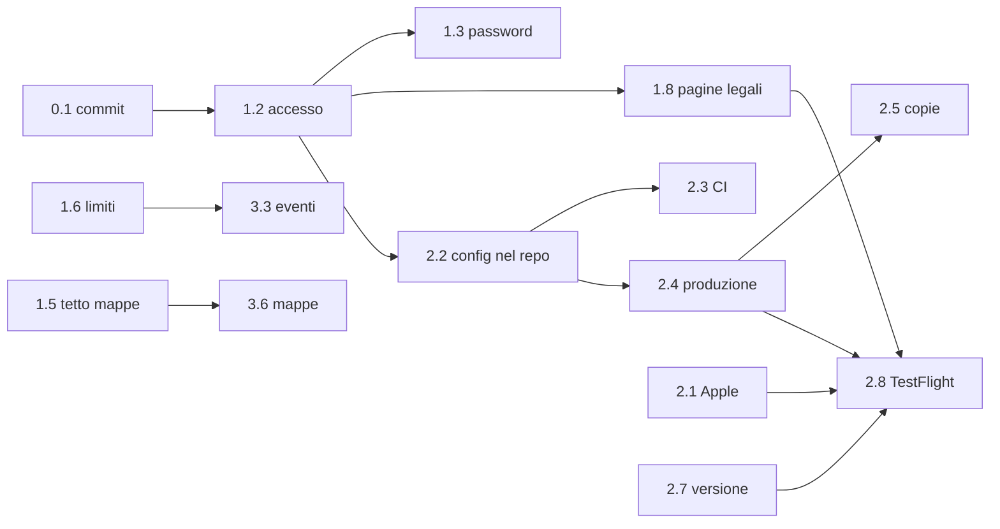

# Piano di intervento

Nasce da [AUDIT.md](AUDIT.md) (14 novembre 2026). Ogni passo è piccolo, sta in piedi da solo e si committa da solo.

**Segni usati**
- 👤 richiede un'azione tua fuori dal codice (pannelli, acquisti, decisioni)
- ⚠️ potenzialmente distruttivo o difficile da annullare
- Effort: S meno di un'ora · M 1–4 ore · L 1–2 giorni · XL più di 2 giorni

**Regole del progetto che valgono per ogni passo** (da `CLAUDE.md`)
- Le migrazioni le preparo io con le loro prove, provate prima in locale su PGlite; **le applichi tu** dall'editor SQL; poi verifico in sola lettura.
- Una schermata nuova si disegna prima sulla tela di Claude Design, poi si costruisce.
- Una funzione nuova nasce con il suo evento, scritto anche in `sito/misurazione.html`.
- Ciò che richiede la rete lo dice prima, con il controllo spento e il motivo.
- Dopo ogni passo sull'app: `flutter analyze` e `flutter test` puliti.

---

## Checklist

### M0 — Mettere al sicuro il lavoro
- [ ] 0.1 Committare e inviare il lavoro in sospeso (QUAL-01)

### M1 — Sicurezza e privacy prima di qualunque tester
- [ ] 1.1 Uscire svuota il telefono (SEC-01)
- [ ] 1.2 👤 Impostazioni dell'accesso su Supabase (SEC-03, SEC-07)
- [ ] 1.3 Recupero e cambio della password (SEC-02)
- [ ] 1.4 La sessione nel Portachiavi (SEC-04)
- [ ] 1.5 Tetto delle mappe per persona e complessivo (SEC-05)
- [ ] 1.6 ⚠️ Limiti di lunghezza sul server (SEC-06)
- [ ] 1.7 Igiene dei permessi (SEC-13, SEC-14)
- [ ] 1.8 👤 Pubblicare le pagine legali (PRIV-01)
- [ ] 1.9 👤 La base giuridica della misurazione (PRIV-02)

### M2 — Fondamenta della beta
- [ ] 2.1 👤 Apple Developer Program (DIST-01)
- [ ] 2.2 La configurazione del server nel repository (DX-01)
- [ ] 2.3 Integrazione continua (QUAL-02)
- [ ] 2.4 👤 ⚠️ Un progetto di produzione separato (ARCH-01)
- [ ] 2.5 👤 Copie di sicurezza (REL-01)
- [ ] 2.6 Raccolta degli errori (OBS-01)
- [ ] 2.7 Una sola versione, e una versione minima (DIST-02, ARCH-02)
- [ ] 2.8 Manifesto della privacy e TestFlight (PRIV-03, DIST-01)

### M3 — Affidabilità e scala
- [ ] 3.1 Gli errori momentanei non sono rifiuti (REL-02)
- [ ] 3.2 La copia si scarica a pagine (REL-03)
- [ ] 3.3 Un evento rifiutato non blocca gli altri (ARCH-04)
- [ ] 3.4 Inviti con scadenza e tentativi contati (SEC-08)
- [ ] 3.5 Una prova che protegge esportazione e chiusura (ARCH-05)
- [ ] 3.6 Mappe: meno scritture per riquadro (PERF-01)

### M4 — Migliorie
- [ ] 4.1 Intestazioni di sicurezza del sito (SEC-12)
- [ ] 4.2 Traguardi da un elenco, tassi con un controllo (SEC-11, SEC-16)
- [ ] 4.3 Aggiornare le dipendenze (QUAL-03)
- [ ] 4.4 Protezione dei file della copia locale (SEC-15)
- [ ] 4.5 Dividere `Archivio`, un'area alla volta (ARCH-03)
- [ ] 4.6 Una prova di flusso intero (QUAL-04)

### M5 — Prima di aprire la parte pubblica
- [ ] 5.1 👤 Togliere i numeri di prova (SEC-09)
- [ ] 5.2 La sospensione sopravvive alla chiusura dell'account (SEC-10)
- [ ] 5.3 Chi ha moderato (SEC-17)
- [ ] 5.4 La ricerca dei viaggiatori con un indice (PERF-03)

**Rimandati finché i numeri non lo chiedono**: sincronizzazione incrementale (PERF-02).

---

## Ordine e dipendenze

I passi che non compaiono (1.1, 1.4, 1.7, 2.6, 3.1, 3.2, 3.4, 3.5 e M4) dipendono solo da 0.1.

Il percorso più corto verso la beta: **M0 → M1 → 2.1, 2.2, 2.4, 2.5, 2.6, 2.7, 2.8**. M3 può cominciare mentre i primi tester provano. L'iscrizione ad Apple (2.1) conviene farla subito: può richiedere giorni.

---

## M0 — Mettere al sicuro il lavoro

### 0.1 — Committare e inviare il lavoro in sospeso
- **Risolve**: QUAL-01
- **Obiettivo**: il lavoro dell'8 novembre (G.3) esiste anche fuori da questo Mac.
- **Prerequisiti**: nessuno.
- **File**: i 46 modificati e gli 8 nuovi che `git status` elenca; `.gitignore`.
- **Modifiche**:
  - Aggiungere `supabase/.temp/` a `.gitignore` e togliere dal tracciamento `supabase/.temp/cli-latest` (`git rm --cached`): è uno stato locale dello strumento.
  - Committare G.3 come le altre fasi (`app, docs, sito, backend: G.3, …`).
  - Committare `AUDIT.md` e `PLAN.md` a parte.
- **Migrazioni / configurazione**: nessuna.
- **Verifica**: `flutter analyze` e `flutter test` prima del commit (oggi: pulito, 885 su 885). Dopo l'invio, `git status -sb` non dice più "ahead".
- **Accettazione**: `origin/main` contiene G.3; l'albero di lavoro è pulito.
- **Rischi e ritorno**: nessuno. È un commit.
- **Effort**: S

---

## M1 — Sicurezza e privacy prima di qualunque tester

### 1.1 — Uscire svuota il telefono
- **Risolve**: SEC-01
- **Obiettivo**: chi entra dopo non trova niente di chi è uscito.
- **Prerequisiti**: 0.1.
- **File**: `app/lib/dati/account.dart`, `app/lib/dati/archivio.dart`, `app/lib/schermate/impostazioni.dart`, `app/lib/schermate/nuovo_profilo.dart`, `app/lib/app.dart`, `app/test/dati/account_test.dart`.
- **Modifiche**:
  1. In `account.dart` una funzione `esci(...)`: con la rete prova `coda.svuota()` e `misurazione.invia()`; poi `svuotaLaCopia()`; poi `signOut()`. I documenti restano: hanno già il proprietario.
  2. `svuotaLaCopia` oggi cancella anche tutte le `impostazioni`. Per l'uscita semplice vanno tenute quelle che riguardano il telefono e non la persona (`primo_ingresso_completato`, altrimenti `installazione_da_invito` verrebbe contata due volte). Va deciso chiave per chiave, e scritto in un elenco esplicito.
  3. In Impostazioni, se in coda ci sono gesti non partiti, il dialogo "Vuoi uscire?" lo dice ("3 cose non sono ancora arrivate agli altri: uscendo si perdono") e uscire resta possibile.
  4. Difesa in profondità in `app.dart`: all'ingresso si confronta l'utente con l'ultimo entrato su questo telefono (una chiave in `impostazioni`); se è un altro, si svuota la copia prima di mostrare qualunque cosa. Copre anche la sessione scaduta o revocata dal server.
  5. `impostazioni.dart:142` e `nuovo_profilo.dart:222` chiamano `esci`.
- **Migrazioni / configurazione**: nessuna.
- **Verifica**: prove nuove in `account_test.dart`: dopo l'uscita copia, coda ed eventi sono vuoti e i documenti dell'altro account restano; entrando come un'altra persona con la copia ancora piena, la copia si svuota; senza rete l'uscita funziona lo stesso. A mano sull'iPhone: due account, uscita e ingresso in modalità aereo.
- **Accettazione**: nessuna riga di un'altra persona è leggibile dopo un cambio di account, con e senza rete; nessun evento parte a nome sbagliato.
- **Rischi e ritorno**: uscendo senza rete i gesti in coda si perdono — è dichiarato nel dialogo. Ritorno: revert del commit.
- **Effort**: M

### 1.2 — 👤 Impostazioni dell'accesso su Supabase
- **Risolve**: SEC-03, SEC-07
- **Obiettivo**: l'accesso non è più quello predefinito.
- **Prerequisiti**: nessuno. Conviene prima di 1.3, che manda email.
- **File**: `docs/punti-aperti.md` (chiudere la voce sulle password compromesse), `app/lib/dati/errori.dart` (il messaggio sui caratteri minimi).
- **Azioni tue nel pannello** (Authentication):
  1. **Conferma dell'email accesa.** Prima guarda chi sono i 2 utenti non confermati: se sono persone di prova, vanno confermati a mano o tolti.
  2. **Password**: lunghezza minima 10; protezione dalle password compromesse accesa.
  3. **URL Configuration**: fra gli indirizzi di ritorno solo `trolley://accesso`.
  4. **SMTP proprio**: scegliere un fornitore di posta (è un responsabile in più: va nell'informativa) e impostarlo. Senza, le email di conferma e di recupero sono poche all'ora.
  5. **Rate limits**: rivedere iscrizioni, accessi e email per indirizzo IP.
  6. **Protezione dai bot** (CAPTCHA) sull'iscrizione: da accendere solo insieme al passo nell'app che manda il token, altrimenti l'iscrizione si rompe. Lo propongo come passo a parte se lo vuoi.
- **Modifiche al codice**: `errori.dart:123` dice "almeno 6 caratteri": allinearlo al nuovo minimo.
- **Verifica**: creare un account di prova: senza conferma non entra; una password di 8 caratteri è rifiutata; una nota come `password123` è rifiutata. Il controllo di sicurezza di Supabase non segnala più la voce.
- **Accettazione**: i quattro controlli sopra passano; l'email di conferma arriva entro un minuto.
- **Rischi e ritorno**: con la conferma accesa, gli account non confermati non entrano più (per questo il punto 1). Ogni impostazione si rimette com'era dal pannello.
- **Effort**: M, più la scelta del fornitore di posta

### 1.3 — Recupero e cambio della password
- **Risolve**: SEC-02
- **Obiettivo**: chi dimentica la password rientra da solo.
- **Prerequisiti**: 1.2 (SMTP e indirizzi di ritorno).
- **File**: tela di Claude Design; `app/lib/schermate/accesso.dart`; una schermata nuova `app/lib/schermate/nuova_password.dart`; `app/lib/app.dart`; `app/lib/schermate/impostazioni.dart`; `app/lib/dati/errori.dart`; `app/lib/misurazione/misurazione.dart`; `sito/misurazione.html`; `docs/tecnico/07-misurazione.md`; `docs/prodotto/01-account-e-profilo.md`; prove in `app/test/schermate/`.
- **Modifiche**:
  1. Disegnare sulla tela: il rimando "Password dimenticata?" nell'accesso, la schermata "Nuova password", la voce "Cambia password" in Impostazioni.
  2. Accesso: il rimando chiama `auth.resetPasswordForEmail(email, redirectTo: redirectAccesso)` attraverso `alServer`. La risposta è sempre la stessa ("Se c'è un account con questa email, ti abbiamo scritto"), per non rivelare chi è iscritto.
  3. `app.dart`: l'ascolto dell'accesso oggi ignora il tipo di evento. Con `AuthChangeEvent.passwordRecovery` si mostra "Nuova password", che chiama `auth.updateUser(UserAttributes(password: …))`.
  4. Impostazioni: "Cambia password" riusa la stessa schermata.
  5. Evento `password_reimpostata` (solo l'azione), anche in `sito/misurazione.html`.
  6. Tutto richiede la rete: controlli spenti con il motivo.
- **Migrazioni / configurazione**: modello dell'email di recupero in italiano (👤 pannello, Authentication → Emails).
- **Verifica**: prove di schermata con l'accesso finto (richiesta inviata, evento di recupero che apre la schermata, password troppo corta rifiutata). A mano sull'iPhone: il giro intero, aprendo il link dal telefono.
- **Accettazione**: da "Password dimenticata?" al rientro in meno di due minuti, senza toccare il pannello.
- **Rischi e ritorno**: il link aperto su un altro dispositivo non funziona (lo schema `trolley://` esiste solo dove c'è l'app): il testo dell'email deve dirlo. Con i link universali (2.8) migliora. Ritorno: revert.
- **Effort**: L

### 1.4 — La sessione nel Portachiavi
- **Risolve**: SEC-04
- **Obiettivo**: il token di rinnovo non sta più in chiaro nelle preferenze.
- **Prerequisiti**: 0.1.
- **File**: `app/pubspec.yaml`, un file nuovo `app/lib/dati/sessione.dart`, `app/lib/main.dart`, una prova in `app/test/dati/`, un ADR nuovo in `docs/tecnico/adr/`.
- **Modifiche**:
  1. Aggiungere `flutter_secure_storage`.
  2. In `sessione.dart` una classe che estende `LocalStorage` di `supabase_flutter` e legge e scrive nel Portachiavi, con accessibilità "dopo il primo sblocco, solo questo dispositivo" (la sessione non migra con i backup).
  3. `main.dart`: `authOptions: FlutterAuthClientOptions(localStorage: …)`.
  4. Migrazione una volta sola: se nel Portachiavi non c'è niente e nelle preferenze c'è la sessione vecchia, la si sposta e la si cancella di là.
  5. Il Portachiavi di iOS sopravvive alla disinstallazione: al primo avvio dopo un'installazione (una chiave nelle preferenze che non c'è ancora) si svuota.
  6. Prima di scrivere, rileggere la documentazione di `supabase_flutter` 2.18 su `LocalStorage`: la firma dei metodi va presa da lì e non a memoria.
- **Migrazioni / configurazione**: nessuna.
- **Verifica**: prova con un deposito finto (migrazione dalla sessione vecchia; primo avvio che svuota). A mano: aggiornando l'app sopra quella installata si resta dentro; disinstallando e reinstallando si riparte dall'accesso.
- **Accettazione**: nelle preferenze dell'app non c'è più alcun token; l'aggiornamento non fa uscire nessuno.
- **Rischi e ritorno**: se la migrazione sbaglia, le persone devono rientrare (con 1.3 non è un dramma). Ritorno: revert; la sessione nel Portachiavi verrebbe ignorata e si rientra una volta.
- **Effort**: M

### 1.5 — Tetto delle mappe per persona e complessivo
- **Risolve**: SEC-05
- **Obiettivo**: un account non può esaurire la mappa di tutti.
- **Prerequisiti**: 👤 sapere la quota giornaliera di Geoapify.
- **File**: nuova migrazione `supabase/migrations/…_tetto_mappe_per_persona.sql`; `supabase/tests/tetto_mappe.sql`; `docs/tecnico/adr/006-mappe-e-percorsi.md`.
- **Modifiche**:
  1. `consuma_mappe` confronta con il tetto la **somma del giorno su tutti i viaggi della persona**, non la riga del singolo viaggio. Il conteggio per viaggio resta, per la misura `consumo_mappe`.
  2. Una chiave nuova in `configurazione.tetto_mappe` (`giorno`): il totale di tutti, per tipo, sotto la quota del fornitore. Superato, la funzione risponde `false` come oggi.
  3. Il totale del giorno si legge da una riga contatore dedicata, non da una somma su tutta la tabella a ogni riquadro.
- **Migrazione**: additiva (una funzione sostituita, una riga di configurazione, una tabella contatore). La applichi tu; poi rilanci `supabase/tests/tetto_mappe.sql`.
- **Verifica**: prove SQL nuove: la stessa persona su due viaggi si ferma al tetto personale; al tetto complessivo si ferma chiunque; il giorno dopo si riparte.
- **Accettazione**: l'app non cambia (gestisce già il 429); le prove passano in locale e sul server.
- **Rischi e ritorno**: un tetto complessivo troppo basso spegne la mappa a tutti: si alza da `configurazione` senza migrazioni. Ritorno: rieseguire la definizione di `consuma_mappe` di prima.
- **Effort**: M

### 1.6 — ⚠️ Limiti di lunghezza sul server
- **Risolve**: SEC-06
- **Obiettivo**: nessun testo senza un massimo.
- **Prerequisiti**: 0.1. Conviene dopo 3.3 se si vuole anche il tetto giornaliero agli eventi (qui non incluso).
- **File**: nuova migrazione `…_limiti_di_lunghezza.sql`; nuovo `supabase/tests/limiti.sql`; `app/lib/dominio/` (costanti dei limiti, dove mancano); le schermate con i campi senza limite; `docs/tecnico/01-modello-dati.md`.
- **Modifiche**:
  1. Stabilire i limiti partendo da quelli che l'app già impone (`lunghezzaMassimaDescrizione = 80`, `lunghezzaMassimaVoce = 200`, `lunghezzaMassimaNota = 20000`) e fissare quelli che mancano: nome della persona, titolo e luogo della tappa, città e periodo del viaggio. I valori li proponiamo insieme; il server tiene un margine sopra l'app.
  2. Vincoli `check` su: `utente.nome`, `viaggio.destinazione_citta`, `viaggio.periodo_approssimativo`, `tappa.titolo`, `tappa.luogo_nome`, `spesa.descrizione`, `evento.nome` (forma `^[a-z_]{1,60}$`), `evento.proprieta` (dimensione entro pochi kilobyte), `evento.versione_app`.
  3. Nell'app, i campi corrispondenti prendono lo stesso limite: così il server non rifiuta mai qualcosa che l'app ha lasciato scrivere.
- **Migrazione — ⚠️**: un vincolo fallisce se una riga esistente lo viola. Si aggiungono come `not valid` e si convalidano dopo aver controllato, con un'interrogazione che preparo, che nessuna riga li superi (oggi: 3 utenti, 11 viaggi). Niente viene cancellato o troncato.
- **Verifica**: prove SQL: ogni campo rifiuta un testo oltre il limite e accetta quello al limite; un evento con nome o proprietà fuori forma è rifiutato. Prove dell'app sui campi.
- **Accettazione**: nessuna colonna di testo scrivibile dall'app è senza massimo; le prove esistenti passano ancora.
- **Rischi e ritorno**: un gesto in coda con un testo oltre il limite verrebbe rifiutato e messo da parte — per questo l'app si allinea nello stesso passo. Un evento rifiutato bloccherebbe l'invio degli altri (ARCH-04): fare 3.3 subito dopo. Ritorno: `alter table … drop constraint …` per ciascun vincolo.
- **Effort**: M

### 1.7 — Igiene dei permessi
- **Risolve**: SEC-13, SEC-14
- **Obiettivo**: nessun permesso più largo del necessario.
- **Prerequisiti**: 0.1.
- **File**: nuova migrazione `…_permessi_stretti.sql`; `supabase/tests/regole_di_accesso.sql`, `tappe.sql`, `spese.sql`, `divisione.sql`.
- **Modifiche**:
  1. Revoca dell'esecuzione a `public` e `anon` sulle cinque funzioni di `privato` rimaste aperte, con il permesso esplicito a chi serve.
  2. `alter default privileges` perché le funzioni future nascano senza esecuzione per `public`.
  3. Su `giorno`, `tappa`, `spesa`, `spesa_quota`: da permesso sull'intera tabella a permessi per colonna, con le sole colonne che l'app scrive. `viaggio_id` non è fra quelle modificabili.
  4. Prima di scrivere l'elenco, ricavarlo dal codice: tutte le colonne che `archivio.dart` e `coda.dart` scrivono su quelle quattro tabelle, comprese le funzioni `security invoker` (`registra_spesa`, `cambia_spesa`, `ordina_tappe`, `applica_giorni`), che girano con i permessi di chi chiama.
- **Migrazione**: la applichi tu. Non tocca i dati.
- **Verifica**: una prova nuova che un partecipante non può cambiare `viaggio_id` di una spesa; tutte le prove SQL esistenti; poi l'app sull'iPhone: aggiungere, spostare, segnare, eliminare una tappa; registrare e cambiare una spesa con le quote; cambiare le date.
- **Accettazione**: l'interrogazione dell'audit ("funzioni eseguibili da anon") restituisce un elenco vuoto; ogni gesto dell'app funziona come prima.
- **Rischi e ritorno**: il rischio vero è dimenticare una colonna, e un gesto dell'app comincia a fallire con 42501. Per questo il punto 4 e il giro a mano. Ritorno: rimettere il permesso sull'intera tabella, una riga per tabella.
- **Effort**: M

### 1.8 — 👤 Pubblicare le pagine legali
- **Risolve**: PRIV-01
- **Obiettivo**: i rimandi dell'app aprono pagine vere.
- **Prerequisiti**: 👤 decidere titolare del trattamento e indirizzo di contatto (con il tuo socio); 1.2 se si aggiunge un fornitore di posta, che va nell'elenco dei responsabili.
- **File**: `sito/privacy.html`, `sito/condizioni.html`, `sito/misurazione.html`, `docs/punti-aperti.md`.
- **Modifiche**: sostituire i segnaposti; aggiornare le date; verificare che la data di `condizioni.html` coincida con `versioneCondizioni` nell'app; aggiungere il fornitore di posta e, se si fa 2.5, la frase sulle copie di sicurezza.
- **Configurazione**: `vercel deploy --prod` dalla cartella `sito/` (lo lancio io se me lo dici, o tu).
- **Verifica**: `/privacy`, `/misurazione`, `/condizioni` rispondono 200; dall'app, i tre rimandi si aprono.
- **Accettazione**: nessun segnaposto nelle pagine pubblicate.
- **Rischi e ritorno**: pubblicare un testo non ancora rivisto dall'avvocato. Le pagine hanno `noindex`; resta una scelta tua se pubblicare la bozza dichiarandola tale o aspettare la revisione. Ritorno: `vercel rollback`.
- **Effort**: S, più la decisione

### 1.9 — 👤 La base giuridica della misurazione
- **Risolve**: PRIV-02
- **Obiettivo**: sapere se la misurazione può partire accesa.
- **Prerequisiti**: nessuno.
- **File**: `docs/legale/per-la-revisione.md` (la domanda c'è già o va aggiunta); a seconda della risposta, `app/lib/misurazione/misurazione.dart` e la schermata del nuovo profilo.
- **Modifiche**: nessuna finché non c'è la risposta. Se serve il consenso: la misurazione parte spenta e la si chiede alla creazione del profilo (schermata da disegnare sulla tela). In ogni caso: decidere per quanto si conservano gli eventi e scriverlo nell'informativa; aggiungere la pulizia pianificata.
- **Verifica / accettazione**: la risposta è scritta in `docs/decisioni/prodotto.md`.
- **Rischi**: con il consenso esplicito i numeri della beta saranno più piccoli; va messo in conto nelle soglie delle ipotesi.
- **Effort**: S per la domanda; M se cambia il comportamento

---

## M2 — Fondamenta della beta

### 2.1 — 👤 Apple Developer Program
- **Risolve**: DIST-01 (prima parte)
- **Obiettivo**: poter firmare e distribuire.
- **Azioni tue**: iscrizione (99 $ l'anno; come persona o come società — con la società serve un numero D-U-N-S e più tempo); decidere il nome definitivo del pacchetto (`com.aionlabs.trolley` oggi) **prima** del primo caricamento, perché dopo non si cambia.
- **Verifica**: in Xcode il team a pagamento firma l'app; il profilo non scade più in 7 giorni.
- **Rischi**: i tempi di approvazione. Per questo va avviata subito, in parallelo a M1.
- **Effort**: S di lavoro, giorni di attesa

### 2.2 — La configurazione del server nel repository
- **Risolve**: DX-01
- **Obiettivo**: rifare il progetto da zero seguendo quello che è scritto.
- **Prerequisiti**: 1.2 (le impostazioni dell'accesso sono quelle giuste).
- **File**: nuovo `supabase/config.toml`; nuovo `README.md` alla radice; `CLAUDE.md` (i comandi di pubblicazione).
- **Modifiche**:
  1. `config.toml` con `verify_jwt = false` per `mappe` e `telefono` (oggi è un'opzione ricordata a mano), e le impostazioni dell'accesso che lo strumento sa descrivere.
  2. `README.md`: come si prepara un progetto nuovo — migrazioni in ordine, funzioni, segreti (i nomi, non i valori), impostazioni del pannello che non stanno in un file, come si costruisce l'app verso un ambiente con `--dart-define`.
- **Verifica**: `supabase functions deploy mappe` senza l'opzione a mano lascia `verify_jwt` spento (lo controllo dall'elenco delle funzioni).
- **Accettazione**: il passo 2.4 si fa seguendo solo il README.
- **Rischi e ritorno**: un `config.toml` sbagliato può cambiare un'impostazione alla pubblicazione successiva: si pubblica una funzione per volta e si controlla. Ritorno: revert.
- **Effort**: M

### 2.3 — Integrazione continua
- **Risolve**: QUAL-02
- **Obiettivo**: analisi e prove girano a ogni invio.
- **Prerequisiti**: 2.2 per la parte SQL.
- **File**: nuovo `.github/workflows/prove.yml`.
- **Modifiche**:
  1. Un lavoro per l'app: `flutter analyze`, `flutter test`, con la versione di Flutter fissata.
  2. Un lavoro per il server: un Postgres pulito, le 28 migrazioni in ordine, poi ogni file di `supabase/tests/`. Le migrazioni usano `pg_cron`, `http` e lo schema `auth`: serve lo stack locale di Supabase (`supabase start`) e non un Postgres nudo. Se si rivela pesante, in un primo momento solo il lavoro dell'app.
  3. Un controllo delle vulnerabilità sul file di blocco (`osv-scanner`).
- **Configurazione**: 👤 verificare che il repository sia privato e quanti minuti gratuiti ha.
- **Verifica**: un invio con una prova rotta apposta fa fallire il lavoro.
- **Accettazione**: il segno verde su `main`; le prove SQL partono da un database vuoto, e così dimostrano anche che le migrazioni si applicano da zero.
- **Rischi e ritorno**: nessuno per l'app. Ritorno: togliere il file.
- **Effort**: M per l'app, L con il server

### 2.4 — 👤 ⚠️ Un progetto di produzione separato
- **Risolve**: ARCH-01
- **Obiettivo**: i dati dei tester non stanno dove si provano le migrazioni.
- **Prerequisiti**: 2.2; meglio dopo M1, così il progetto nuovo nasce già con tutto.
- **File**: `app/lib/configurazione.dart`; `README.md`; `CLAUDE.md`; un ADR nuovo.
- **Modifiche**:
  1. 👤 Creare il progetto `trolley-prod` (regione europea). `trolley-db` resta lo sviluppo.
  2. Applicare le migrazioni in ordine, pubblicare le due funzioni, mettere i segreti (**senza** `TELEFONO_PROVA`), rifare le impostazioni dell'accesso di 1.2.
  3. Lanciare tutte le prove SQL sul progetto nuovo, ancora vuoto.
  4. `configurazione.dart`: togliere i valori predefiniti che puntano allo sviluppo. La build di rilascio riceve indirizzo e chiave con `--dart-define`; senza, non parte. Così non può uscire una build di beta che punta al database sbagliato.
  5. Scrivere come si passa una migrazione da sviluppo a produzione: prima di là con le prove, poi di qua.
- **⚠️ Attenzione**: i tuoi 11 viaggi restano nello sviluppo. Se li vuoi in produzione, vanno ricreati o esportati con "I tuoi dati": non c'è un'importazione. Da decidere prima.
- **Verifica**: l'app costruita per la produzione crea un account e un viaggio di là; nello sviluppo non compare niente.
- **Accettazione**: due progetti, due build distinguibili (un nome o un'icona diversa per lo sviluppo aiuta), nessun dato di prova in produzione.
- **Rischi e ritorno**: il piano gratuito consente due progetti attivi; di più no. Ritorno: rimettere i valori predefiniti.
- **Effort**: L

### 2.5 — 👤 Copie di sicurezza
- **Risolve**: REL-01
- **Obiettivo**: un errore sul database si recupera.
- **Prerequisiti**: 2.4.
- **Due strade**:
  - **Piano a pagamento di Supabase per `trolley-prod`** (circa 25 $ al mese): copie giornaliere, e il progetto non va in pausa. È quella che raccomando dal giorno in cui entra il primo tester.
  - **Un `pg_dump` pianificato**, cifrato, in uno spazio privato: costa quasi zero, ma è un pezzo in più da mantenere, apre un secondo posto dove stanno i dati (da dichiarare), e non risolve la pausa.
- **File**: `sito/privacy.html` (per quanto restano le righe cancellate nelle copie — è già fra i punti aperti); `docs/punti-aperti.md`.
- **Verifica**: **provare un ripristino** una volta, su un progetto di scarto. Una copia mai ripristinata non è una copia.
- **Accettazione**: esiste una copia di ieri e si sa quanto ci vuole a rimetterla.
- **Effort**: S (piano) o M (dump)

### 2.6 — Raccolta degli errori
- **Risolve**: OBS-01
- **Obiettivo**: sapere quando l'app di un tester si rompe.
- **Prerequisiti**: 👤 scegliere la strada.
- **Due strade**:
  - **Una tabella propria** (`errore`: tipo, traccia tagliata, versione, sistema), scritta con una coda locale come gli eventi. Nessun fornitore nuovo, coerente con il resto. È quella che raccomando per la beta.
  - **Un servizio esterno** (Sentry, regione europea): più ricco, ma è un responsabile in più da dichiarare e va configurato perché non raccolga contenuti.
- **File** (prima strada): migrazione `…_errori.sql` con le regole e le prove; `app/lib/dati/errori_del_telefono.dart` dietro un'interfaccia; `app/lib/main.dart`; `sito/privacy.html` e `sito/misurazione.html`; un ADR.
- **Modifiche**:
  1. In `main.dart`: `FlutterError.onError`, `PlatformDispatcher.instance.onError`, e l'avvio dentro una zona protetta.
  2. Si raccoglie **il tipo dell'errore e la traccia**, mai il messaggio (può contenere testi della persona), con la versione dell'app. Segue l'interruttore della misurazione, o uno suo: è una scelta da scrivere.
  3. Un tetto: non più di qualche decina di errori al giorno per telefono, e gli stessi errori contati una volta.
  4. Rivedere i 37 punti che ingoiano gli errori: quelli attesi restano, gli altri passano dal raccoglitore.
- **Verifica**: prova con un errore lanciato apposta: finisce nella coda con tipo e traccia e senza messaggio; sull'iPhone, un errore di prova arriva sul server.
- **Accettazione**: un'interrogazione dice quali errori sono capitati ieri, per versione.
- **Rischi e ritorno**: una traccia può rivelare poco di personale ma non niente: va detto nell'informativa. Ritorno: revert; la tabella resta vuota.
- **Effort**: M–L

### 2.7 — Una sola versione, e una versione minima
- **Risolve**: DIST-02, ARCH-02
- **Obiettivo**: gli eventi dicono la versione vera, e una build troppo vecchia chiede di aggiornare.
- **Prerequisiti**: 0.1.
- **File**: `app/pubspec.yaml` (`package_info_plus` da dipendenza indiretta a diretta); `app/lib/configurazione.dart`; `app/lib/main.dart`; `app/lib/app.dart`; una schermata "Aggiorna Trolley" (prima sulla tela); migrazione `…_versione_minima.sql` (una riga in `configurazione`); prove.
- **Modifiche**:
  1. `versioneApp` si legge dal pacchetto all'avvio, non da una costante.
  2. `configurazione.versione_minima`: l'app la legge (c'è già la copia locale di `configurazione`) e, se è più vecchia, mostra la schermata di aggiornamento al posto delle sezioni. Senza rete vale l'ultimo valore noto, e i documenti restano leggibili.
- **Migrazione**: additiva.
- **Verifica**: prova di dominio sul confronto fra versioni; a mano, alzando il valore sul server di sviluppo.
- **Accettazione**: cambiando una riga sul server, una build vecchia smette di scrivere e lo dice.
- **Rischi e ritorno**: un valore sbagliato chiude fuori tutti: si corregge dalla stessa riga. Ritorno: rimettere `0.0.0`.
- **Effort**: M

### 2.8 — Manifesto della privacy e TestFlight
- **Risolve**: PRIV-03, DIST-01 (seconda parte)
- **Obiettivo**: la prima build nelle mani di un tester.
- **Prerequisiti**: 2.1, 2.4, 2.7, 1.8.
- **File**: nuovo `app/ios/Runner/PrivacyInfo.xcprivacy`; `app/ios/Runner/Info.plist`; `app/ios/Runner/Runner.entitlements` (nuovo, per i domini associati); `sito/.well-known/apple-app-site-association` (nuovo); `sito/vercel.json`; `sito/invito.html` (`LINK_STORE`); `docs/tecnico/adr/004-deep-link-differito.md`.
- **Modifiche**:
  1. Il manifesto: i dati raccolti (email, data di nascita, contenuti dei viaggi, uso del prodotto) e le API con motivazione obbligatoria usate dall'app e dai suoi pacchetti.
  2. 👤 Le dichiarazioni di privacy su App Store Connect, coerenti con l'informativa.
  3. Link universali: il file di associazione sul sito e i domini associati nell'app, così `https://…/i/CODICE` apre l'app senza passare da `trolley://`. `codiceDaLink` lo riconosce già.
  4. 👤 Decidere il dominio dei link d'invito prima di mandare inviti veri: cambiarlo dopo rompe quelli già inviati.
  5. Caricare la build e invitare i primi tester interni.
- **Verifica**: su un telefono che non è il tuo: installazione da TestFlight, apertura di un link d'invito, ingresso nel viaggio giusto.
- **Accettazione**: un tester entra in un viaggio partendo da un link in una chat, senza il tuo aiuto.
- **Rischi**: la revisione di Apple per i tester esterni può chiedere modifiche; i tester interni (fino a 100, con un ruolo nel tuo team) non passano dalla revisione.
- **Effort**: L

---

## M3 — Affidabilità e scala

### 3.1 — Gli errori momentanei non sono rifiuti
- **Risolve**: REL-02
- **Obiettivo**: un guasto del server non mette da parte i gesti.
- **File**: `app/lib/dati/errori.dart`, `app/lib/dati/coda.dart`, `app/test/dati/coda_test.dart` (o il file che prova la coda).
- **Modifiche**: `alServer` riconosce gli errori momentanei — risposte 5xx, 429, `57014` (timeout dell'istruzione), `40001` e `40P01` (conflitti di transazione) — e li trasforma in un errore con `serveLaRete: true`: la coda si ferma senza contare il tentativo, e riparte alla prossima occasione. Verificare nel pacchetto `postgrest` come arriva lo stato HTTP nell'eccezione, invece di supporlo.
- **Verifica**: prove: un 503 non aumenta i tentativi e non mette da parte; un 42501 sì, come oggi.
- **Accettazione**: dopo un guasto simulato, la coda è intatta e parte da sola.
- **Rischi e ritorno**: un errore permanente scambiato per momentaneo terrebbe ferma la coda del viaggio: l'elenco dei codici resta corto ed esplicito. Ritorno: revert.
- **Effort**: M

### 3.2 — La copia si scarica a pagine
- **Risolve**: REL-03
- **Obiettivo**: nessuna riga sparisce perché la risposta è stata tagliata.
- **Prerequisiti**: 👤 leggere "Max rows" in Settings → API.
- **File**: `app/lib/dati/archivio.dart` (`aggiornaCopia` e le altre letture di elenchi), prove in `app/test/dati/`.
- **Modifiche**: una funzione che legge una tabella a pagine (`range`) con un ordine stabile (`id`) finché una pagina arriva incompleta, usata da tutte le letture di `aggiornaCopia`. Se una pagina fallisce, la copia resta quella di prima, come oggi. In più, un controllo di coerenza: se il server restituisce esattamente il massimo senza che sia stata chiesta la pagina dopo, è un errore e non una copia.
- **Verifica**: prova con un server finto che taglia a 3 righe: la copia le contiene tutte.
- **Accettazione**: un viaggio con 1.500 tappe di prova si scarica intero (sul progetto di sviluppo).
- **Rischi e ritorno**: più chiamate per aggiornamento con i viaggi grandi; con quelli normali resta una. Ritorno: revert.
- **Effort**: M–L

### 3.3 — Un evento rifiutato non blocca gli altri
- **Risolve**: ARCH-04
- **Obiettivo**: la misurazione non si spegne in silenzio.
- **Prerequisiti**: meglio subito dopo 1.6.
- **File**: `app/lib/misurazione/misurazione.dart`, `app/lib/dati/database.dart` (una colonna dei tentativi su `evento_in_attesa`: è una migrazione locale, e va provato che la coda sopravvive), prove.
- **Modifiche**: se un lotto è rifiutato dal server (non per la rete), lo si rimanda un evento alla volta; quello che il server rifiuta ancora viene scartato dopo pochi tentativi, e lo scarto passa dal raccoglitore di 2.6. Gli errori di rete restano come oggi.
- **Verifica**: prova: un evento malformato in mezzo a dieci; gli altri nove partono.
- **Accettazione**: nessuna condizione ferma l'invio per sempre.
- **Effort**: M

### 3.4 — Inviti con scadenza e tentativi contati
- **Risolve**: SEC-08
- **Obiettivo**: un link vecchio non apre il viaggio per sempre.
- **Prerequisiti**: 👤 decidere la durata (proposta: 30 giorni, o fino alla fine del viaggio se viene prima). È una scelta di prodotto: va in `docs/decisioni/prodotto.md`.
- **File**: migrazione `…_inviti_che_scadono.sql`; `supabase/tests/partecipanti.sql`; `app/lib/schermate/partecipanti.dart` (mostrare la scadenza, creare un link nuovo); `docs/prodotto/03-partecipanti-e-inviti.md`.
- **Modifiche**: una colonna `scade_il` su `invito`; `accetta_invito` la controlla; una tabella privata dei codici sbagliati per persona e giorno, con un tetto (per esempio 10), come quella dei tentativi del telefono; un errore dedicato per "invito scaduto", con un messaggio che dice di chiederne uno nuovo.
- **Migrazione**: additiva. Agli inviti esistenti si dà la scadenza a partire da oggi, non dalla creazione, per non rompere link appena mandati.
- **Verifica**: prove SQL: scaduto rifiutato; undicesimo codice sbagliato rifiutato anche se giusto; il giorno dopo si riparte.
- **Rischi e ritorno**: chi apre un link dopo la scadenza resta fuori finché non ne riceve uno nuovo: il messaggio deve essere chiaro. Ritorno: `scade_il` a `null` per tutti.
- **Effort**: M

### 3.5 — Una prova che protegge esportazione e chiusura
- **Risolve**: ARCH-05
- **Obiettivo**: una tabella nuova con dati personali non può restare fuori.
- **File**: nuovo `supabase/tests/dati_personali.sql`.
- **Modifiche**: una prova che elenca dal catalogo ogni tabella di `public` e `privato` con una colonna che punta a `utente`, e fallisce se il suo nome non compare nel corpo di `chiudi_account` e — per quelle che la persona deve poter esportare — di `i_miei_dati`, salvo un elenco esplicito di eccezioni motivate.
- **Verifica**: aggiungendo in locale una tabella di prova, la prova fallisce.
- **Effort**: M

### 3.6 — Mappe: meno scritture per riquadro
- **Risolve**: PERF-01
- **Obiettivo**: una schermata di mappa non costa quaranta scritture.
- **Prerequisiti**: 1.5. Da fare solo quando i numeri lo chiedono.
- **File**: `supabase/functions/mappe/index.ts`, una migrazione, `app/lib/dati/mappe.dart`, ADR-006.
- **Modifiche (proposta)**: la funzione chiede al database un blocco di riquadri (per esempio 50) e riceve un permesso firmato che vale pochi minuti; i riquadri successivi presentano quello, e la funzione lo verifica da sola. Il tetto resta esatto a meno di un blocco.
- **Effort**: L

---

## M4 — Migliorie

### 4.1 — Intestazioni di sicurezza del sito
- **Risolve**: SEC-12 · **File**: `sito/vercel.json`, `sito/invito.html`
- **Modifiche**: `X-Frame-Options: DENY`, `X-Content-Type-Options: nosniff`, e una `Content-Security-Policy` stretta. La pagina d'invito ha script e stile in linea: o si spostano in file, o la politica li ammette con un'impronta.
- **Verifica**: `curl -I` mostra le intestazioni; la pagina d'invito funziona ancora (copia del codice, apertura dell'app).
- **Effort**: S

### 4.2 — Traguardi da un elenco, tassi con un controllo
- **Risolve**: SEC-11, SEC-16 · **File**: una migrazione, `supabase/tests/chiusura.sql`, `supabase/tests/spese.sql`
- **Modifiche**: `prendi_traguardi` accetta solo i tipi che l'app conosce (l'elenco va tenuto uguale a `dominio/traguardi.dart`: una prova lo confronta); `aggiorna_tassi` scarta un tasso che si muove oltre una soglia rispetto all'ultimo noto, e lo lascia com'era.
- **Rischi**: un traguardo nuovo nell'app va aggiunto anche al server: è un accoppiamento in più, accettato perché il conteggio è pubblico.
- **Effort**: S–M

### 4.3 — Aggiornare le dipendenze
- **Risolve**: QUAL-03 · **File**: `app/pubspec.yaml`, `app/pubspec.lock`
- **Modifiche**: `flutter pub upgrade` entro i vincoli, un commit a sé; poi capire da dove arrivano `sqlite3_flutter_libs +eol` e `sqlcipher_flutter_libs +eol` e se `drift_flutter` ha una strada nuova. Gli aggiornamenti maggiori uno per volta.
- **Verifica**: prove, poi il giro a mano sull'iPhone delle parti native: documenti, scansione, posizione, notifiche, mappa.
- **Ritorno**: revert del file di blocco.
- **Effort**: M

### 4.4 — Protezione dei file della copia locale
- **Risolve**: SEC-15 · **File**: `app/ios/Runner/DocumentiDelTelefono.swift` (o un canale accanto), `app/lib/dati/database.dart`
- **Modifiche**: protezione "completa finché non aperto" sul file del database e sui riquadri in memoria. Non "completa" e basta: i promemoria e l'invio della coda possono girare a telefono bloccato.
- **Verifica**: prova sull'iPhone con `xcodebuild test`, come per i documenti.
- **Effort**: S–M

### 4.5 — Dividere `Archivio`, un'area alla volta
- **Risolve**: ARCH-03 · **File**: `app/lib/dati/archivio.dart` e file nuovi accanto
- **Modifiche**: estrarre un'area per commit — account e profilo, spese, liste, partecipanti, note, chiusura — lasciando in `Archivio` la copia e la coda. Le schermate continuano a passare da `Servizi`. Nessun cambio di comportamento: le prove esistenti sono il criterio.
- **Quando**: non prima della beta. Conviene farlo man mano che si tocca ciascuna area per altri motivi.
- **Effort**: XL in tutto, M per area

### 4.6 — Una prova di flusso intero
- **Risolve**: QUAL-04 · **File**: nuovo `app/integration_test/`
- **Modifiche**: una prova contro il progetto di sviluppo: iscrizione, profilo, viaggio, invito accettato da un secondo account, spesa registrata senza rete e arrivata al ritorno, chiusura dell'account. Dopo 2.4, perché serve un ambiente che si può sporcare.
- **Effort**: L

---

## M5 — Prima di aprire la parte pubblica

Non servono per la beta fra amici e parenti con la parte pubblica chiusa. Vanno fatti tutti prima di cambiarne lo stato.

### 5.1 — 👤 Togliere i numeri di prova
- **Risolve**: SEC-09 · **Azione**: `supabase secrets unset TELEFONO_PROVA` sul progetto di produzione (con 2.4 non ci arriva nemmeno). In più, nella funzione: se la parte pubblica è `aperta`, i numeri di prova non valgono, qualunque cosa dica il segreto.
- **Effort**: S

### 5.2 — La sospensione sopravvive alla chiusura dell'account
- **Risolve**: SEC-10 · **File**: una migrazione, `supabase/tests/sicurezza.sql`, `sito/privacy.html`
- **Modifiche**: chiudendo un account sospeso si conserva l'impronta del numero (con un segreto del server), per una durata dichiarata; `telefono_invio` la controlla. Va deciso con chi rivede la parte legale: è un dato conservato dopo la chiusura.
- **Effort**: M

### 5.3 — Chi ha moderato
- **Risolve**: SEC-17 · **File**: una migrazione sullo schema `moderazione`
- **Modifiche**: una tabella di registro (quando, quale azione, su quale segnalazione, quale utente del database), scritta dalle funzioni di moderazione.
- **Effort**: S

### 5.4 — La ricerca dei viaggiatori con un indice
- **Risolve**: PERF-03 · **Modifiche**: una tabella derivata (persona, paese, città, mese più recente) aggiornata alla chiusura di un viaggio e ai cambi di visibilità, con un indice. Solo se la parte pubblica supera qualche migliaio di profili.
- **Effort**: L

---

## Decisioni che aspettano te

| Decisione | Per quale passo | Nota |
|---|---|---|
| Titolare del trattamento e contatto | 1.8 | Con il tuo socio |
| Fornitore di posta per le email dell'accesso | 1.2 | Un responsabile in più nell'informativa |
| Pubblicare l'informativa in bozza o dopo la revisione | 1.8 | |
| Iscrizione ad Apple: persona o società | 2.1 | Da avviare subito |
| Nome definitivo del pacchetto e dominio degli inviti | 2.1, 2.8 | Dopo non si cambiano |
| Portare o no i tuoi viaggi in produzione | 2.4 | |
| Piano a pagamento o `pg_dump` | 2.5 | Raccomando il piano |
| Tabella propria o servizio esterno per gli errori | 2.6 | Raccomando la tabella |
| Quota di Geoapify, per il tetto complessivo | 1.5 | |
| Durata degli inviti | 3.4 | |
| Lunghezze massime dei campi | 1.6 | Le propongo io, le confermi tu |
